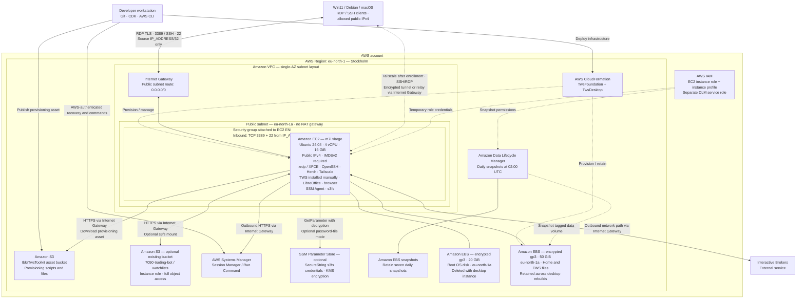

# ibkr-tws-cdk

An Ubuntu workstation for Interactive Brokers TWS, deployed with TypeScript CDK.

- **TwsFoundation:** single public subnet in `eu-north-1a`, retained encrypted 50 GiB gp3 data disk, daily snapshots at 02:00 UTC with seven retained. Stack termination protection is enabled.
- **TwsDesktop:** Ubuntu 24.04 amd64, On-Demand `m7i.xlarge` (4 vCPU / 16 GiB), encrypted disposable 20 GiB root disk, XFCE/xrdp, OpenSSH, LibreOffice, Firefox, Neovim, Herdr, Python and uv.
- Public SSH and RDP accept only `IP_ADDRESS/32`. Tailscale is installed for optional private access; the TWS API has no inbound rule. EC2 requires IMDSv2.
- `/srv/tws/home` is mounted at `/home/trader`. Home files survive desktop rebuilds; root-installed software, account passwords and SSH host keys do not. The data disk must remain in its AZ and attach to only one desktop.

## Architecture

The diagram shows the current CDK configuration. TWS is installed manually. The default S3 mount uses the EC2 instance role.



See [the detailed architecture documentation](docs/architecture.md) for stack ownership, resource lifecycle, and access details.

## Setup and deploy

Requires Node.js 22 or newer supported LTS, npm, AWS CLI v2, PowerShell 7 and OpenSSH. Authenticate profile `poweruser`; deployment requires CloudFormation, EC2, IAM role creation/passing, DLM and CDK asset permissions.

```powershell
npm ci
# On a fresh clone only; preserve an existing .env:
Copy-Item .env.example .env
```

Edit local `.env` (Git-ignored):

```dotenv
IP_ADDRESS=203.0.113.10
SSH_PUBLIC_KEYS_FILE=~/.ssh/id_ed25519.pub
```

Use your **client's public IPv4**, not a LAN or EC2 address. Only IPv4 or `/32` is accepted. The key file can contain multiple public keys; comments are stripped and private keys are never uploaded. Keep the matching private keys on your SSH clients. `~/` expands to your home; relative paths resolve from the repository.

Defaults are in `config/workstation.json`; optional `config/local.json` overrides are Git-ignored. The AMI is pinned; blank `amiId` opts into Canonical's current Ubuntu image and may cause future replacement. EBS volumes can grow but cannot shrink in place.

```powershell
npm run build
npm test
npm run synth
# Bootstrap once per environment, if IbkrTwsToolkit does not already exist:
npx cdk bootstrap aws://YOUR_ACCOUNT_ID/eu-north-1 --toolkit-stack-name IbkrTwsToolkit --qualifier ibkrtws --profile poweruser
npx cdk diff --all --profile poweruser
npx cdk deploy --all --profile poweruser --require-approval never
```

`--require-approval never` skips CDK security-change prompts. Review the diff first. Deployment waits up to 40 minutes for first-boot provisioning. Builds, tests and synthesis alone do not deploy resources. The toolkit bucket stores provisioning assets; changing its name/qualifier requires a migration.

## Connect: SSH, sudo and RDP

```powershell
.\scripts\workstation.ps1 status
.\scripts\workstation.ps1 session -IdentityFile ~/.ssh/id_ed25519
```

Or connect directly from Windows, Debian or macOS:

```bash
ssh -i ~/.ssh/id_ed25519 trader@EC2_PUBLIC_IP
sudo -i                       # Passwordless root shell; exit returns to trader
sudo passwd trader            # Set an account password only for RDP
```

SSH uses public keys only; direct root SSH is disabled. No account password or AWS credentials are needed for direct SSH. SSM remains an optional fallback, not part of routine administration.

On Win11, open `mstsc`, connect to the current EC2 public IP, and log in as `trader` using the RDP password. Choose Xorg if prompted. xrdp starts at boot; the XFCE session starts on login. Validate the self-signed certificate. Disconnecting preserves the session; logging out ends it.

A **reboot keeps the public IP**; stop/start or recreation can change it. Rebuilt instances have new host keys: verify the new fingerprint before updating `known_hosts`.

Install TWS manually as `trader` under `/home/trader` (for example `~/Jts`). Enable socket API clients in TWS and prefer localhost-only access. IBKR login/MFA remains interactive. TWS is not installed or started automatically.

Herdr is installed at `~/.local/bin/herdr`, pinned by version and checksum in `provision/herdr-release.json`. Run it directly, or configure an SSH alias and use `herdr --remote YOUR_ALIAS` from a client with Herdr installed. Agent credentials and automatic Herdr startup are not configured.

## Python and uv

Provisioning installs Ubuntu Python 3, `python` as its alias, pip, venv, development headers and build tools. uv/uvx install system-wide in `/usr/local/bin`, pinned by version and SHA-256 in `provision/uv-release.json`. The installer does not change user shell profiles or replace Ubuntu's Python.

```bash
python --version
python3 --version
uv --version
cd ~/trading-bot
uv sync
uv run python --version
```

`uv sync` uses the project's Python requirement and lockfile, creating `.venv` as needed. Use virtual environments for dependencies rather than installing into the Ubuntu-managed Python. Project-specific Python versions can be managed with uv; system Python remains Ubuntu's default.

## Join Tailscale later

Tailscale installs from its official stable apt repository on new instances and provisioning updates. `tailscaled` starts at boot; enrollment is manual and no auth key is stored in Git/CDK. For an existing instance, deploy the provisioning update, or run the standalone installer over SSH without restarting the workstation.

On EC2, after installation:

```bash
sudo tailscale up --hostname=ibkr-tws --ssh=false
# Open the displayed login URL in your browser and approve the device.
tailscale ip -4
tailscale status
```

Install Tailscale on your Windows, Debian or macOS client and sign into the same tailnet. Allow TCP 22 and 3389 in your tailnet access policy. Connect using the reported Tailscale IP or MagicDNS hostname:

```bash
ssh -i ~/.ssh/id_ed25519 trader@TAILSCALE_IP
sudo -i
```

On Windows: `mstsc /v:TAILSCALE_IP`. Use the trader RDP password as usual. `--ssh=false` preserves ordinary OpenSSH with your defined key and passwordless sudo; Tailscale SSH is not enabled. No extra public security-group ports are opened. Public `IP_ADDRESS` filtering remains as a fallback; tailnet connections use Tailscale access controls instead.

Enrollment survives reboot and stop/start. State is stored on the root disk (`/var/lib/tailscale`), so a rebuilt instance must be enrolled again; remove stale devices from the Tailscale admin console. Device approval/key expiry follow your tailnet policy. Existing enrolled machines retain their identity and preferences when provisioning runs again.

## Update IP, packages and services

Edit `.env` or provisioning files, then:

```powershell
npx cdk diff TwsDesktop --profile poweruser
npx cdk deploy TwsDesktop --profile poweruser --require-approval never
```

| Change                                      | Result                                                                                                            |
| ------------------------------------------- | ----------------------------------------------------------------------------------------------------------------- |
| Only `IP_ADDRESS` in `.env`                 | Updates SSH/RDP rules in place; no EC2 restart or replacement.                                                    |
| Packages, keys, files, hooks or S3 settings | Updates user data; CloudFormation can stop/start the existing EBS-backed instance. Configuration applies at boot. |
| AMI, AZ or other immutable infrastructure   | May require replacement; inspect the diff.                                                                        |

CDK rereads `.env` on every invocation; file values override inherited environment variables. Run the normal app, not a stale `--app cdk.out`. AWS API access lets you deploy a new client IP even while SSH/RDP is blocked.

Save work before provisioning updates. CDK can report **conditional replacement** for user-data changes; EBS-backed instances restart for that change. `tws-config-update.service` applies changed configuration using IMDSv2, records a successful hash, and retries failures on the next boot. Unchanged boots skip provisioning. Existing root files, passwords and host keys survive these in-place updates. Stack completion does not confirm the asynchronous apply: check its journal.

| File/directory                  | Purpose                                                                                                     |
| ------------------------------- | ----------------------------------------------------------------------------------------------------------- |
| `provision/packages.txt`        | Apt packages, one per line, e.g. `neovim`. Removing an entry does not uninstall it.                         |
| `provision/files/rootfs/`       | Root overlay: `etc/example.conf` becomes `/etc/example.conf`; existing directory permissions are preserved. |
| `provision/hooks/pre-install/`  | Root scripts before packages and data mounts.                                                               |
| `provision/hooks/post-install/` | Root scripts after packages, mounts and files.                                                              |
| `provision/hooks/first-use/`    | Once per persistent disk; completion marker written on success.                                             |
| `provision/hooks/every-boot/`   | Root scripts at every boot, after persistent mounts.                                                        |
| `~/.config/autostart/`          | Trader's GUI startup applications.                                                                          |

Hooks run alphabetically and must be idempotent. Use `runuser -u trader -- ...` for user commands. Add custom systemd unit files through the overlay and enable them in a post-install hook. Removed overlay files are not automatically deleted. Keep secrets out of provisioning assets and Git.

## S3 mount

Defaults mount `s3://7050-trading-bot/watchlists/` at `/mnt/watchlists` using temporary EC2 role credentials, with full object access confined to that prefix. Bucket location and prefix-limited listing are also allowed; bucket administration and other prefixes are excluded. No Parameter Store secret or static access key is needed.

Change `bucket`, `prefix`, `s3Region` and `s3ReadWrite` in configuration, or clear `bucket` to disable the mount. s3fs mounts the existing bucket/prefix at `/mnt/watchlists` through `tws-s3fs.service`, at boot. It uses trader's UID/GID (UID 1100), `allow_other`, `mp_umask=022` and `compat_dir`. `s3ReadWrite: true` grants `s3:*` on objects under the configured prefix and enables writes; false limits object access to reads. The prefix and required permissions must already exist; SSE-KMS buckets may need additional KMS permissions.

Choose credentials:

- **Instance role:** leave `PARAM_STORE_KEY_S3_PASSWD` blank. Uses temporary role credentials scoped to the configured bucket/prefix.
- **Parameter Store:** create a SecureString in the stack account/region containing `ACCESS_KEY_ID:SECRET_ACCESS_KEY`. Give that IAM key its own limited S3 permissions. Put only references in `.env`:

```dotenv
PARAM_STORE_KEY_S3_PASSWD=/ibkr-tws/s3fs/passwd
S3_PASSWD_KMS_KEY_ARN=
```

The optional key ARN is for a customer-managed Parameter Store KMS key. EC2 fetches the secret when the mount service starts and writes `/etc/passwd-s3fs` as root, mode 0600; CDK never resolves it. Other parameter reads are denied. A custom KMS key policy must also permit decryption. Never put credentials in `.env`, Git or shell history.

Rotating the value at the same parameter name needs no deploy: close files and restart `tws-s3fs`. Changing the reference or mount settings requires deployment. S3 is not POSIX storage: avoid concurrent edits and verify important saves. The shutdown helper refuses busy mounts rather than forcing an unmount.

## Stop, start and rebuild

```powershell
.\scripts\workstation.ps1 status
.\scripts\workstation.ps1 start
# Save work and close TWS, LibreOffice, browsers and Herdr:
.\scripts\workstation.ps1 stop -ApplicationsClosed
# Remove the desktop stack, retaining the foundation/data disk:
.\scripts\workstation.ps1 down -ApplicationsClosed
npx cdk deploy TwsDesktop --profile poweruser --require-approval never
```

SSH helpers use your agent/default identities or `-IdentityFile PATH`. Stop/down run passwordless sudo checks through SSH, sync and normally unmount S3. They abort on errors; application detection is not exhaustive. `down` prompts for confirmation. Stops end processes; they are not hibernation. No daily shutdown schedule is installed.

EBS, snapshots and CDK assets incur storage costs while compute is stopped. Public IPv4 is billed while allocated. The foundation is protected and retains its disk; destroying stacks does not automatically clean up all retained resources or existing S3 buckets.

## Troubleshooting

```bash
sudo journalctl -u tws-config-update.service -b
sudo tail -n 50 /var/log/tws-bootstrap.log
sudo systemctl status ssh xrdp tws-s3fs
```

First-boot logs are also in `/var/log/cloud-init-output.log`. For older installations with a root-owned `~/.local` (Neovim permission errors), run `sudo chown trader:trader /home/trader/.local`. The installer now repairs ownership of both `.local` and `.local/bin` before checking the Herdr binary.

The EC2 logical ID is pinned to preserve its deployed identity. Older instances predating the boot updater need a one-time SSH installation of that service before migration. Do not rename foundation constructs or change the data disk's AZ casually.

## References

- [Detailed architecture](docs/architecture.md)
- [EC2 user-data update behavior](https://docs.aws.amazon.com/AWSCloudFormation/latest/TemplateReference/aws-resource-ec2-instance.html#cfn-ec2-instance-userdata)
- [s3fs options](https://github.com/s3fs-fuse/s3fs-fuse/blob/master/doc/man/s3fs.1.in)
- [Herdr installation](https://herdr.dev/docs/install/) and [remote access](https://herdr.dev/docs/persistence-remote/)

- [Tailscale Linux installation](https://tailscale.com/docs/install/linux)
