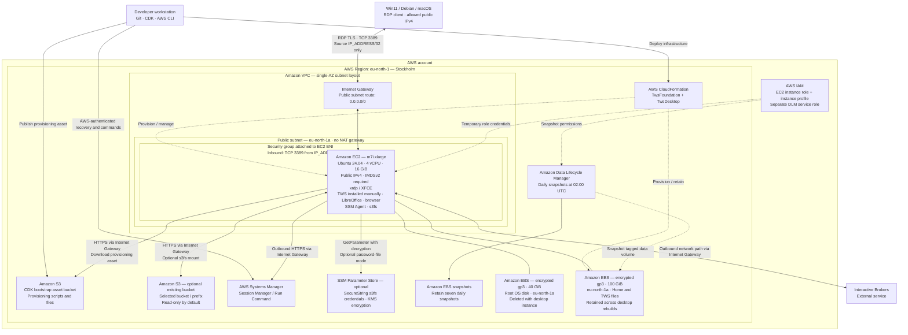

# ibkr-tws-cdk

First iteration of a persistent Ubuntu desktop for Interactive Brokers TWS. TypeScript CDK creates CloudFormation stacks. Nothing is deployed by cloning, installing dependencies, building, testing, or synthesizing.

## Design

- `TwsFoundation`: one public subnet in a fixed Availability Zone, no NAT gateway, encrypted retained 100 GiB gp3 data disk, daily snapshots at 02:00 UTC with seven retained snapshots. Foundation termination protection is enabled in the CDK app.
- `TwsDesktop`: On-Demand m7i.xlarge (4 vCPU / 16 GiB), Ubuntu 24.04 x86-64, encrypted disposable 40 GiB root disk, IMDSv2, SSM access and a narrowly scoped instance role. No SSH key.
- Public IPv4 enables direct RDP access and outbound connectivity. The security group permits TCP 3389 only from the single IPv4 host in `IP_ADDRESS` (`/32`). SSH and the TWS API have no inbound rules. Tailscale is deferred and is not installed.
- `/srv/tws/home` is bind-mounted at `/home/trader`. Put TWS and its settings there. Never attach this disk to two desktop instances simultaneously. The instance is tied to the data volume's AZ; this is not high availability.
- Root packages are recreated on rebuild. Home files survive, but running sessions, unsaved work and the trader password do not. Set the password after each rebuild. Existing snapshots are crash-consistent; close apps before taking a manual snapshot for a known clean recovery point.

## Architecture

The diagram shows the current CDK configuration. TWS is installed manually, and the S3 data mount is optional.



See [the detailed architecture documentation](docs/architecture.md) for stack ownership, resource lifecycle, and access details.

## Prerequisites

Node.js 22 LTS (current maintained patch) or newer supported LTS, npm, AWS CLI v2, PowerShell 7, and the Session Manager plugin. AWS profile `poweruser` must be authenticated. Creating/passing IAM roles, CloudFormation, EC2, DLM and CDK asset permissions are needed; the profile name does not establish permissions. If these are missing, use an administrator-approved deployment role.

## Configure and validate

```powershell
npm ci
# .env is created locally; on a fresh clone use: Copy-Item .env.example .env
# Edit .env and set IP_ADDRESS to your client public IPv4 (not the EC2 IP).
# Optional: copy config/workstation.json to config/local.json and edit overrides.
npm run build
npm test
npm run synth
```

Defaults: Stockholm (`eu-north-1` / `eu-north-1a`), no S3 mount. Set `bucket` to your chosen bucket (for example `my-tws-files`), optional `prefix`, and explicitly opt into `s3ReadWrite`. A configured prefix must not contain shell metacharacters or spaces. Select the bucket's region when practical; cross-region S3 traffic may cost extra. SSE-KMS buckets may additionally require narrowly scoped KMS permissions and key policy access.

The AMI is resolved from Canonical's public SSM parameter at deployment time. Set `amiId` to a reviewed Ubuntu 24.04 amd64 image for repeatable rebuilds. Apt packages follow Ubuntu repositories unless pinned with `name=version`; this iteration is not a bit-for-bit reproducible image build.

## Client IP configuration

The local, Git-ignored `.env` file contains:

```dotenv
# Replace with your actual public client IPv4; this is a documentation example.
IP_ADDRESS=203.0.113.10
```

The initially created local file is blank on purpose: fill it before synthesis/deployment. A plain IPv4 or IPv4 with `/32` is accepted; missing/invalid values, IPv6 and wider CIDRs fail synthesis. The address is the public source seen by AWS (your router/VPN egress), not your LAN address or the EC2 destination address. No automatic external IP discovery is performed.

CDK reads the file on every app invocation, including `diff` and `deploy`. The file takes precedence over an inherited shell `IP_ADDRESS`; if absent, an environment variable can supply it for CI. The app reads only the named settings documented here; the entire file is not exported or copied onto EC2. The source IP appears in the CloudFormation template/security-group rule, and in local `cdk.out` (also Git-ignored).

After changing only `IP_ADDRESS`:

```powershell
npx cdk diff TwsDesktop --profile poweruser
npx cdk deploy TwsDesktop --profile poweruser
```

This updates the security-group ingress rule in place, removing the old address and adding the new one. The IP is deliberately excluded from user data and provisioning assets, so an IP-only edit does not replace/reboot EC2 or reinstall applications. A regression test verifies this. AWS CLI/CDK access does not depend on the RDP allowlist, so you can make this update from your new network. Reconnect RDP after deployment.

Use the normal CDK app, not `--app cdk.out` or another previously synthesized assembly: a saved assembly retains its old IP until re-synthesized. Editing the file alone changes nothing in AWS; `diff` previews and `deploy` applies it. If other configuration or assets also changed, inspect the full diff for replacements. `cdk bootstrap` prepares deployment support resources; the client IP takes effect when deploying `TwsDesktop`, not during toolkit bootstrapping.

## Deploy (creates billable resources)

```powershell
aws sts get-caller-identity --profile poweruser
# Inspect the existing CDKToolkit stack first. Bootstrap only if needed:
npx cdk bootstrap aws://YOUR_ACCOUNT_ID/eu-north-1 --profile poweruser
npx cdk diff --all --profile poweruser
npx cdk deploy --all --profile poweruser
```

Configure matching account/region context when bootstrapping another region. The deployment waits up to 40 minutes for provisioning to succeed. Provisioning errors after AWS CLI installation signal failure; earlier errors time out. Bootstrap logs: `/var/log/cloud-init-output.log` and `/var/log/tws-bootstrap.log`. A failed desktop deployment leaves the foundation/data disk intact.

## First login / after rebuilding

```powershell
.\scripts\workstation.ps1 session
```

In the SSM shell:

```bash
sudo passwd trader
sudo systemctl status xrdp
```

Run `.\scripts\workstation.ps1 status` to get the instance's current public IPv4. On Win11 open `mstsc` and connect to that address with username `trader` from the allowed client IP. The default xrdp certificate is self-signed; validate the server identity before accepting the certificate prompt. Use Ubuntu's Xorg session supplied by xrdp. Disconnecting preserves the session while the instance runs; logging out ends it. Only use this remote desktop session for the trader user. The public address can change after stop/start; use `status` again rather than relying on a saved destination.

TWS itself is **not silently downloaded or installed** in v0.1. Obtain the Linux installer from Interactive Brokers, run it as trader, and select a directory beneath `/home/trader` (for example `/home/trader/Jts`). Enable API socket clients, prefer localhost-only access, and keep credentials out of provisioning. For automation add a reviewed, version/checksum-pinned installer in a post-install hook, running the actual install as trader. IBKR login/MFA remains interactive. Sizing and responsiveness need validation with your TWS layout before relying on it for trading.

## Customize like a provisioning recipe

- `provision/packages.txt`: Ubuntu apt packages, one per line.
- `provision/files/rootfs/`: managed root filesystem overlay; e.g. `etc/example.conf` is copied to `/etc/example.conf`. Do not put secrets here.
- `provision/hooks/pre-install/*.sh`: before apt packages/data mount.
- `provision/hooks/post-install/*.sh`: after packages, mounts and managed files.
- `provision/hooks/first-use/*.sh`: once per persistent disk; marker written only on success.
- `provision/hooks/every-boot/*.sh`: root commands via systemd every boot, after persistent mounts.
- GUI commands: trader's `~/.config/autostart/`. Seed user settings only if absent. Use `runuser -u trader -- ...` for non-root commands, with an explicit working directory as needed.

Hooks run alphabetically and fail on nonzero exit. Write idempotent scripts. CDK uploads the provision directory as an asset; no Git credentials on the instance. Asset changes alter user data and force a desktop replacement. **Use clean `down` followed by deploy for provisioning changes** (an IP-only security-group edit does not need this), not an in-place deployment against a running instance. A direct replacement can race attachment of the single-AZ disk or interrupt applications. Update protection and `cdk diff` review are essential; do not rename foundation constructs or change its AZ casually.

## S3

An optional s3fs systemd service mounts the configured bucket/prefix at `/mnt/watchlists`, during bootstrap and every boot (not just desktop login). Set `bucket`, `prefix` (default `watchlists`), and `s3Region` in configuration. The prefix must already exist and the credentials must permit s3fs's metadata/list operations there. `s3ReadWrite` defaults to false; set it to true to enable saving files. This adds `-o ro` when false, including in password-file mode.

The mount uses `endpoint`, regional HTTPS `url`, `use_path_request_style`, `allow_other`, `mp_umask=022`, and `compat_dir`, as in the proposed script. UID/GID come from `id trader` (UID 1100), not an assumed 1000. It runs in the foreground under systemd; no local HTTP control API or persistent VFS cache is used. s3fs can still use temporary local disk space while handling files.

Two credential modes:

1. **Instance role**: leave `PARAM_STORE_KEY_S3_PASSWD` blank. s3fs uses `iam_role=auto` and temporary credentials. CDK grants the instance role access to the configured S3 prefix.
2. **Password file from Parameter Store**: create a **SecureString** parameter in the stack region, containing one line in the format `ACCESS_KEY_ID:SECRET_ACCESS_KEY`. Use a dedicated IAM user's key with access limited to the bucket/prefix. Store the complete password-file line as the parameter value, using the AWS console or another secure administration workflow. Never put that value in `.env`, shell history, Git or CDK context.

For password-file mode, set only references in local `.env`:

```dotenv
PARAM_STORE_KEY_S3_PASSWD=/ibkr-tws/s3fs/passwd
# Optional: ARN of the customer-managed KMS key encrypting this parameter.
S3_PASSWD_KMS_KEY_ARN=
```

CDK does not fetch or resolve the secret during synthesis/deployment. EC2 runs `aws ssm get-parameter --with-decryption` when the mount service starts; the response is processed in a root-only temporary directory under `/run` and deleted. The helper validates SecureString type and credential format, then atomically installs `/etc/passwd-s3fs` with owner root and mode 0600 on the encrypted root disk. It never prints the value. Missing parameters, permission errors or invalid contents fail service startup and initial bootstrap. Nothing is created in Parameter Store by this project.

The instance role can read the selected parameter. An explicit deny prevents the SSM core managed policy's broad `GetParameter/GetParameters` grants from reading other parameters in this mode (SSM features that need additional parameters would require deliberately revising this restriction). For a customer-managed key, CDK grants `kms:Decrypt` on that key, restricted to SSM and the selected parameter's encryption context; the key policy must also allow it. With the default `aws/ssm` key, no additional key ARN is required. Parameter and key must be in the stack account/region. These credentials authorize the s3fs S3 requests independently of the EC2 role; scope the IAM user's S3 policy separately. Bucket SSE-KMS permissions are a separate concern.

The service fetches the latest parameter value at each boot or `sudo systemctl restart tws-s3fs`. Close all files first. Rotating the **value at the same parameter name** needs no CDK deploy; restart the service or instance to pick it up. Changing the **parameter name**, S3 configuration or provisioning assets changes bootstrap and requires a reviewed desktop rebuild. The actual secret remains readable to root and is necessarily used locally by s3fs; it is not exposed in CloudFormation templates or the CDK asset.

Inspect with `sudo systemctl status tws-s3fs` and `sudo journalctl -u tws-s3fs`. S3 is not a shared POSIX filesystem; avoid concurrent editing of the same object from multiple machines. Close/save applications before shutdown. The lifecycle helper syncs and performs a normal unmount, refusing a busy/failed unmount; there is no forced or lazy unmount fallback. A clean unmount is not a guarantee against every remote service failure, so verify important saves.

## Daily lifecycle

```powershell
.\scripts\workstation.ps1 status
.\scripts\workstation.ps1 start
# Save work and close TWS, LibreOffice and Firefox before stopping:
.\scripts\workstation.ps1 stop -ApplicationsClosed
# Clean stop and remove ONLY compute; CDK prompts for destroy confirmation:
.\scripts\workstation.ps1 down -ApplicationsClosed
# Recreate the desktop, reusing the foundation disk:
npx cdk deploy TwsDesktop --profile poweruser
```

Stop/down checks common application processes, syncs and normally unmounts s3fs before stopping. A busy or failed unmount aborts the operation. It does not force-close applications and is not an exhaustive detector for arbitrary custom apps. Do not restart writers after initiating shutdown. If checks fail, inspect SSM command output and fix the issue; there is no force-delete fallback. If already stopped, down skips remote checks. Stopping is a normal shutdown, not hibernation. No automatic daily shutdown schedule is installed in this iteration.

EBS, snapshots and CDK assets continue to cost money with compute down; public IPv4 is charged while allocated/running. Foundation deletion is intentionally protected and retains the disk; retained resources/snapshots require a separate deliberate cleanup. No resources are deleted automatically from existing S3 buckets. Test deployment/rebuild/reconnect/restore with a paper account before production use.

## References

- [CDK assets](https://docs.aws.amazon.com/cdk/v2/guide/assets.html)
- [EC2 user data](https://docs.aws.amazon.com/AWSEC2/latest/UserGuide/user-data.html)
- [EC2 security-group changes](https://docs.aws.amazon.com/AWSEC2/latest/UserGuide/changing-security-group.html)
- [Canonical Ubuntu AMI discovery](https://documentation.ubuntu.com/aws/aws-how-to/instances/find-ubuntu-images/)

- [s3fs options and credential files](https://github.com/s3fs-fuse/s3fs-fuse/blob/master/doc/man/s3fs.1.in)
- [Parameter Store SecureString encryption](https://docs.aws.amazon.com/systems-manager/latest/userguide/secure-string-parameter-kms-encryption.html)
