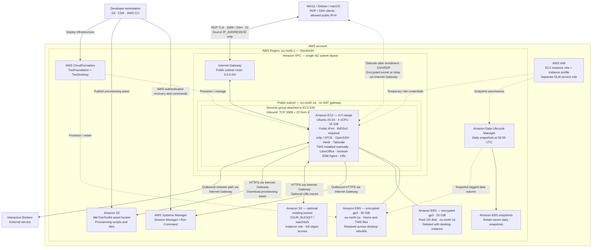

# ibkr-tws-cdk

An Ubuntu workstation for Interactive Brokers TWS, deployed with TypeScript CDK.

- **TwsFoundation:** single public subnet in `eu-north-1a`, retained encrypted 50 GiB gp3 data disk, daily snapshots at 02:00 UTC with seven retained. Stack termination protection is enabled.
- **TwsDesktop:** Ubuntu 24.04 amd64, On-Demand `m7i.xlarge` (4 vCPU / 16 GiB), encrypted disposable 20 GiB root disk, XFCE/xrdp, OpenSSH, LibreOffice, Firefox, Neovim, Herdr, Python and uv.
- Public SSH and RDP accept only `IP_ADDRESS/32`. Tailscale is installed for optional private access; the TWS API has no inbound rule. EC2 requires IMDSv2.
- `/srv/tws/home` is mounted at `/home/trader`. Home files survive desktop rebuilds; root-installed software, account passwords and SSH host keys do not. The data disk must remain in its AZ and attach to only one desktop.

## Architecture

The diagram shows the current CDK configuration. TWS is installed manually. The optional S3 mount uses the EC2 instance role.



See [the detailed architecture documentation](docs/architecture.md) for stack ownership, resource lifecycle, and access details.

## Setup and deploy

Requires Node.js 22 or newer supported LTS, npm, AWS CLI v2, PowerShell 7 and OpenSSH. Authenticate profile `poweruser`; deployment requires CloudFormation, EC2, IAM role creation/passing, DLM and CDK asset permissions.

```powershell
npm ci
# On a fresh clone only; preserve an existing .env:
Copy-Item .env.example .env
```

Edit local `.env` (Git-ignored):

```dotenv
IP_ADDRESS=203.0.113.10
SSH_PUBLIC_KEYS_FILE=~/.ssh/id_ed25519.pub
```

Use your **client's public IPv4**, not a LAN or EC2 address. Only IPv4 or `/32` is accepted. The key file can contain multiple public keys; comments are stripped and private keys are never uploaded. Keep the matching private keys on your SSH clients. `~/` expands to your home; relative paths resolve from the repository.

Defaults are in `config/workstation.json`; optional `config/local.json` overrides are Git-ignored. The AMI is pinned; blank `amiId` opts into Canonical's current Ubuntu image and may cause future replacement. EBS volumes can grow but cannot shrink in place.

```powershell
npm run build
npm test
npm run synth
# Bootstrap once per environment, if IbkrTwsToolkit does not already exist:
npx cdk bootstrap aws://YOUR_ACCOUNT_ID/eu-north-1 --toolkit-stack-name IbkrTwsToolkit --qualifier ibkrtws --profile poweruser
npx cdk diff --all --profile poweruser
npx cdk deploy --all --profile poweruser --require-approval never
```

`--require-approval never` skips CDK security-change prompts. Review the diff first. Deployment waits up to 40 minutes for first-boot provisioning. Builds, tests and synthesis alone do not deploy resources. The toolkit bucket stores provisioning assets; changing its name/qualifier requires a migration.

## Connect: SSH, sudo and RDP

### Lifecycle: PowerShell

- Run these commands from the repository with AWS profile `poweruser` authenticated.

```powershell
.\scripts\workstation.ps1 status
.\scripts\workstation.ps1 start
.\scripts\workstation.ps1 stop
.\scripts\workstation.ps1 down
npx cdk deploy TwsDesktop --profile poweruser --require-approval never
```

- `start` waits for EC2 health checks; desktop services may need longer.
- `stop` requests normal OS shutdown and waits, even with applications running.
- `down` stops EC2, then confirms desktop-stack deletion while retaining the foundation/data disk.
- Redeploy `TwsDesktop` to rebuild the desktop from the retained data disk.
- Save work first; unsaved changes can be lost during shutdown.
- Stopping is not hibernation, and no daily shutdown schedule is configured.
- EBS, snapshots and CDK assets still incur storage charges while stopped.

### Lifecycle: Linux

- Use the same helper through PowerShell 7: `pwsh ./scripts/workstation.ps1 status`.
- Alternatively, use AWS CLI directly:

```bash
export AWS_PROFILE=poweruser AWS_DEFAULT_REGION=eu-north-1
INSTANCE_ID=$(aws cloudformation describe-stacks --stack-name TwsDesktop --query "Stacks[0].Outputs[?OutputKey=='InstanceId'].OutputValue | [0]" --output text)
aws ec2 describe-instances --instance-ids "$INSTANCE_ID" --query 'Reservations[0].Instances[0].{State:State.Name,IP:PublicIpAddress}' --output table
aws ec2 start-instances --instance-ids "$INSTANCE_ID"
aws ec2 wait instance-status-ok --instance-ids "$INSTANCE_ID"
```

- To stop and wait for normal OS shutdown:

```bash
aws ec2 stop-instances --instance-ids "$INSTANCE_ID" --no-force --no-skip-os-shutdown
aws ec2 wait instance-stopped --instance-ids "$INSTANCE_ID"
```

### SSH and sudo: all clients

- Connect through Tailscale with the private key matching `SSH_PUBLIC_KEYS_FILE`.

```bash
ssh -i ~/.ssh/id_ed25519 trader@ibkr-tws
sudo -i
```

- `sudo` is passwordless; direct root SSH and SSH password authentication are disabled.
- Use the current public IP instead of `ibkr-tws` when connecting without Tailscale.
- Reboot preserves the public IP; stop/start or recreation can change it.
- Verify new SSH host keys after rebuilding before updating `known_hosts`.

### Remote desktop

- Start the workstation and connect your client to the same Tailscale network.
- Enroll new instances using the [Tailscale setup](#tailscale) below.
- Once per new root disk, SSH in and run `sudo passwd trader` to set the RDP password.
- Replace `<PASS>` below with that password; setting a local `.env` value does not change it on EC2.
- Validate the server certificate and select **Xorg** if prompted.

#### Windows

```powershell
cmdkey /generic:TERMSRV/ibkr-tws /user:trader /pass:"<PASS>"; mstsc /v:ibkr-tws
```

- The command saves the password in Windows Credential Manager.
- Remove it with `cmdkey /delete:TERMSRV/ibkr-tws`.

#### Linux
```bash
TRADER_PASS='<PASS>'
xfreerdp3 /v:ibkr-tws /u:trader /p:"$TRADER_PASS" /bpp:24 +clipboard /dynamic-resolution
```
- Install FreeRDP 3 with `sudo apt install freerdp3-x11` where available.
- Leave the domain empty; omit `/p:` to enter the password interactively.
- `/p:` exposes the password in the client process arguments.

#### macOS

- Add a PC named `ibkr-tws` in Windows App and connect as `trader` with the RDP password.

#### RDP client configuration
- xrdp starts at boot; XFCE starts on desktop login.
- Without Tailscale, replace `ibkr-tws` with the current public IP; your client must match `IP_ADDRESS/32`.
- Close the client to preserve running applications; logging out ends the desktop.
- Reconnecting to an existing desktop depends on xrdp's session-matching policy.

**Keep `/bpp:24`.** At the default 32-bit colour, Ubuntu's xrdp 0.9 sends planar-compressed bitmaps that FreeRDP 3 rejects: the session drops right after login with `planar_decompress failed`. If 24-bit still fails, try `/bpp:16` or `-compression`. The certificate, `BB_ERROR_BLOB`, `messageChannelId` and keycode warnings are harmless.

##### RDP responsiveness

- **Network path:** over Tailscale, run `tailscale ping ibkr-tws`. `via DERP(...)` means relayed traffic with extra latency; the public-IP route may then be faster.
- **Client:** a fixed size sends fewer pixels than `/dynamic-resolution`. Turn off sound and visual extras: `xfreerdp3 /v:ibkr-tws /u:trader /bpp:24 +clipboard /size:1920x1080 /network:broadband-high /audio-mode:2 -wallpaper -themes`. `/bpp:16` halves bandwidth, with some colour banding.
- **Provisioned server tuning:** XFCE window compositing is turned off at each login (`/etc/xdg/autostart/tws-xfwm4-no-compositing.desktop`), xrdp uses an 8 MiB TCP send buffer, and `/etc/sysctl.d/90-xrdp.conf` raises `net.core.wmem_max` to 8 MiB to allow it. To keep compositing, remove that autostart file from `provision/files/rootfs/etc/xdg/autostart/` and from the instance (overlay removals are not applied automatically).
- **In the session:** turn off the XFCE screensaver/locker, use a flat theme without animations, and turn off Firefox smooth scrolling.

## IBKR TWS

### Installation and Setup

- Install TWS manually as `trader` under `~/Jts`; automatic installation/startup is not configured.
- Enable socket API clients and restrict access to localhost.
- Complete IBKR login/MFA interactively.

### Performance Tuning

- **Reduce desktop workload:** close unused charts, windows, and layouts to minimize memory and CPU usage.
- **Java heap size:** TWS performance improves significantly with appropriate JVM heap allocation. Set via Global Configuration → General. For typical API usage:
  - Recommended: `-Xms512m -Xmx2048m` (512 MB initial, 2 GB max)
  - Light usage: `-Xms256m -Xmx1024m` (256 MB initial, 1 GB max)
  - Heavy data/chart usage: `-Xms1024m -Xmx4096m` (1 GB initial, 4 GB max)
- **Garbage collection tuning:** for low-latency API work, consider `-XX:+UseG1GC -XX:MaxGCPauseMillis=50` to reduce GC pause times.
- **Other JVM flags:** `-XX:-TieredCompilation` disables tiered compilation (faster startup, lower overhead); `-XX:+AlwaysPreTouch` pre-allocates heap memory (more predictable latency).
- **Memory allocation:** leave sufficient RAM for the OS and other applications. Monitor with `free -h` or system tools. See [IBKR memory guidance](https://www.interactivebrokers.com/docs/third-party-integrations/tws-settings/memory-allocation).
- **Network optimization:** if using RDP, higher latency can degrade responsiveness; consider `net.core.wmem_max` tuning (already set to 4 MiB in this provisioning).

## Herdr

Herdr is installed at `~/.local/bin/herdr`, pinned by version and checksum in `provision/herdr-release.json`. Run it directly on the workstation, or connect from a client with Herdr installed. Agent credentials and automatic Herdr startup are not configured.

To connect from a client, first add an SSH host alias to `~/.ssh/config`:

```sshconfig
Host tws-workstation
  HostName ibkr-tws          # Tailscale MagicDNS name, Tailscale IP or EC2 public IP
  User trader
  IdentityFile ~/.ssh/id_ed25519
  IdentitiesOnly yes
```

Check it with `ssh tws-workstation`, then register the workstation in Herdr:

```bash
herdr machine add tws-workstation --label <label>
```

You can also connect without registering it: `herdr --remote tws-workstation`.

## Python and uv

Provisioning installs Ubuntu Python 3, `python` as its alias, pip, venv, development headers and build tools. uv/uvx install system-wide in `/usr/local/bin`, pinned by version and SHA-256 in `provision/uv-release.json`. The installer does not change user shell profiles or replace Ubuntu's Python.

```bash
python --version
python3 --version
uv --version
cd ~/trading-bot
uv sync
uv run python --version
```

`uv sync` uses the project's Python requirement and lockfile, creating `.venv` as needed. Use virtual environments for dependencies rather than installing into the Ubuntu-managed Python. Project-specific Python versions can be managed with uv; system Python remains Ubuntu's default.

## Tailscale

- Provisioning installs Tailscale and starts `tailscaled`; enrollment is manual.
- On each new instance, connect over public SSH and run:

```bash
sudo tailscale up --hostname=ibkr-tws --ssh=false
tailscale ip -4
tailscale status
```

- Open the displayed login URL and approve the device if required.
- Sign your clients into the same tailnet and enable MagicDNS for `ibkr-tws`.
- Allow TCP 22 and 3389 in the tailnet access policy.
- `--ssh=false` preserves ordinary OpenSSH key authentication and passwordless sudo.
- Enrollment survives stop/start but must be repeated after root-disk recreation.
- Remove stale devices after rebuilding and check device key expiry in the admin console.
- See the [Tailscale CLI reference](https://tailscale.com/docs/reference/tailscale-cli/up) for enrollment options.

## Update IP, packages and services

Edit `.env` or provisioning files, then:

```powershell
npx cdk diff TwsDesktop --profile poweruser
npx cdk deploy TwsDesktop --profile poweruser --require-approval never
```

| Change                                      | Result                                                                                                            |
| ------------------------------------------- | ----------------------------------------------------------------------------------------------------------------- |
| Only `IP_ADDRESS` in `.env`                 | Updates SSH/RDP rules in place; no EC2 restart or replacement.                                                    |
| Packages, keys, files, hooks or S3 settings | Updates user data; CloudFormation can stop/start the existing EBS-backed instance. Configuration applies at boot. |
| AMI, AZ or other immutable infrastructure   | May require replacement; inspect the diff.                                                                        |

CDK rereads `.env` on every invocation; file values override inherited environment variables. Run the normal app, not a stale `--app cdk.out`. AWS API access lets you deploy a new client IP even while SSH/RDP is blocked.

Save work before provisioning updates. CDK can report **conditional replacement** for user-data changes; EBS-backed instances restart for that change. `tws-config-update.service` applies changed configuration using IMDSv2, records a successful hash, and retries failures on the next boot. Unchanged boots skip provisioning. Existing root files, passwords and host keys survive these in-place updates. Stack completion does not confirm the asynchronous apply: check its journal.

| File/directory                  | Purpose                                                                                                     |
| ------------------------------- | ----------------------------------------------------------------------------------------------------------- |
| `provision/packages.txt`        | Apt packages, one per line, e.g. `neovim`. Removing an entry does not uninstall it.                         |
| `provision/files/rootfs/`       | Root overlay: `etc/example.conf` becomes `/etc/example.conf`; existing directory permissions are preserved. |
| `provision/hooks/pre-install/`  | Root scripts before packages and data mounts.                                                               |
| `provision/hooks/post-install/` | Root scripts after packages, mounts and files.                                                              |
| `provision/hooks/first-use/`    | Once per persistent disk; completion marker written on success.                                             |
| `provision/hooks/every-boot/`   | Root scripts at every boot, after persistent mounts.                                                        |
| `~/.config/autostart/`          | Trader's GUI startup applications.                                                                          |

Hooks run alphabetically and must be idempotent. Use `runuser -u trader -- ...` for user commands. Add custom systemd unit files through the overlay and enable them in a post-install hook. Removed overlay files are not automatically deleted. Keep secrets out of provisioning assets and Git.

## S3 mount
- With S3 already configured, mount and verify the bucket using the existing service:

```bash
sudo systemctl start tws-s3fs
findmnt /mnt/watchlists
ls /mnt/watchlists
```

- The service mounts the configured bucket/prefix at `/mnt/watchlists` automatically at boot.
- s3fs uses temporary EC2 role credentials; no password file or Parameter Store secret is needed.
- If unconfigured, set `bucket` in Git-ignored `config/local.json`, then deploy `TwsDesktop`.
- Defaults use prefix `watchlists`; the role grants object access only within the configured prefix.
- Set `s3ReadWrite: false` for read-only access; bucket administration remains excluded.
- Changing the bucket/prefix requires deployment to update both IAM and mount settings.
- S3 is not POSIX storage; avoid concurrent edits and verify important saves.

## Troubleshooting

```bash
sudo journalctl -u tws-config-update.service -b
sudo tail -n 50 /var/log/tws-bootstrap.log
sudo systemctl status ssh xrdp tws-s3fs
```

First-boot logs are also in `/var/log/cloud-init-output.log`. For older installations with a root-owned `~/.local` (Neovim permission errors), run `sudo chown trader:trader /home/trader/.local`. The installer now repairs ownership of both `.local` and `.local/bin` before checking the Herdr binary.

The EC2 logical ID is pinned to preserve its deployed identity. Older instances predating the boot updater need a one-time SSH installation of that service before migration. Do not rename foundation constructs or change the data disk's AZ casually.

## References

- [Detailed architecture](docs/architecture.md)
- [EC2 user-data update behavior](https://docs.aws.amazon.com/AWSCloudFormation/latest/TemplateReference/aws-resource-ec2-instance.html#cfn-ec2-instance-userdata)
- [s3fs options](https://github.com/s3fs-fuse/s3fs-fuse/blob/master/doc/man/s3fs.1.in)
- [Herdr installation](https://herdr.dev/docs/install/) and [remote access](https://herdr.dev/docs/persistence-remote/)

- [Tailscale Linux installation](https://tailscale.com/docs/install/linux)

## OS security alternative

See [security setup and validation](docs/security.md) for this branch's local-only monitoring configuration.
