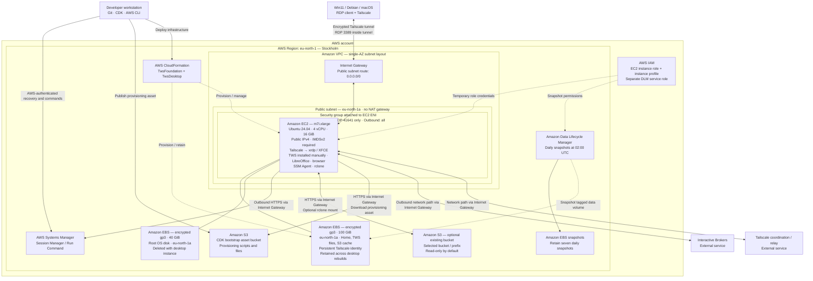

# Workstation architecture

This diagram describes the current CDK source and default configuration, not a verified live deployment. AWS resource names are used; diagram boxes are schematic, not official AWS icons.

## Ownership and lifecycle

| Layer | Managed resources | Behavior |
| --- | --- | --- |
| `TwsFoundation` | VPC, subnet, routing, Internet Gateway, persistent EBS volume, DLM policy and DLM role | Kept during desktop teardown; stack termination protection enabled; data volume has retention policies. |
| `TwsDesktop` | EC2, root EBS disk, security group, instance role/profile, data-volume attachment | Cleanly stop, destroy and recreate; existing data disk is reattached in the same AZ. |
| CDK bootstrap | Deployment roles and S3 assets bucket | Created separately by `cdk bootstrap`, retained independently of desktop stack. |
| Existing S3 data bucket | Optional user-selected bucket/prefix | Not created or deleted by this project. Bucket region may differ from the illustrated region. |

## Access and provisioning details

- RDP binds to the Tailscale IPv4 address. Public TCP 3389, SSH and the TWS API are not opened. Configure Tailscale grants to restrict permitted devices/users.
- Tailscale attempts a direct encrypted connection; it can fall back to an external relay. The EC2 host still uses the Internet Gateway for internet connectivity. Its public IPv4 address is not an Elastic IP and can change after stop/start.
- Systems Manager works through outbound connections; no inbound management port is required. No VPC endpoints, VPN gateway, NAT gateway or load balancer is configured.
- S3 and Systems Manager are regional services outside the VPC. EBS volumes are AZ resources attached to EC2, not resources inside its subnet. IAM is account-scoped.
- Cloud-init downloads a CDK S3 asset, installs packages, copies managed files and executes custom hooks. Systemd runs the every-boot hooks. Asset access uses the instance role, not stored AWS access keys.
- Localhost-only TWS API access is the recommended application setting; it must be enabled/configured in TWS. No separate IB Gateway process is provisioned.
- S3 mounting is disabled in the default configuration. When enabled, rclone uses the instance role and caches files on persistent EBS. S3 is not the home directory or a native shared filesystem.
- TWS installation, initial Tailscale enrollment, desktop password setup and IBKR login remain first-use operations. Rebuilds retain data and Tailscale state, not running application sessions.
