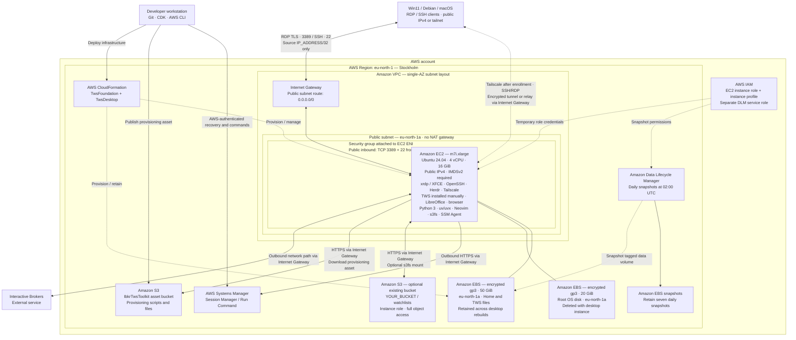

# Workstation architecture

This diagram describes the current CDK source and default configuration, not a verified live deployment. AWS resource names are used; diagram boxes are schematic, not official AWS icons.

## Ownership and lifecycle

| Layer                   | Managed resources                                                                      | Behavior                                                                                                                                         |
| ----------------------- | -------------------------------------------------------------------------------------- | ------------------------------------------------------------------------------------------------------------------------------------------------ |
| `TwsFoundation`         | VPC, subnet, routing, Internet Gateway, persistent EBS volume, DLM policy and DLM role | Kept during desktop teardown; stack termination protection enabled; data volume has retention policies.                                          |
| `TwsDesktop`            | EC2, root EBS disk, security group, instance role/profile, data-volume attachment      | Routine configuration updates preserve EC2; explicit desktop teardown deletes the root disk and reattaches the retained data disk on recreation. |
| CDK bootstrap           | Deployment roles and S3 assets bucket                                                  | Created separately as `IbkrTwsToolkit` with qualifier `ibkrtws`; retained independently of the desktop stack.                                    |
| Existing S3 data bucket | Optional user-selected bucket/prefix                                                   | Not created or deleted by this project. Bucket region may differ from the illustrated region.                                                    |

## Access and provisioning details

- Public xrdp (TCP 3389) and SSH (TCP 22) are restricted by the security group to `IP_ADDRESS/32` from local `.env`. Tailscale connections use tailnet access policies instead; no extra public ingress ports are added. SSH requires the configured public key; the TWS API has no inbound rule.
- RDP connects directly through the Internet Gateway with TLS. Tailscale is installed with its daemon enabled at boot; enroll manually to add private SSH/RDP access. Enrollment uses `tailscale up --ssh=false`, preserving normal OpenSSH and its key authentication. Tailnet identity survives reboot/stop/start but is stored on the root disk and must be enrolled again after recreation. Public IP-filtered access remains available. The public IPv4 is not an Elastic IP: reboot keeps it; stop/start or recreation can change it.
- The README documents a FreeRDP 3 `/bpp:24` workaround for bitmap decoding problems. Provisioning disables XFCE compositing at login and configures a 4 MiB xrdp TCP send buffer with a matching `net.core.wmem_max` sysctl. xrdp starts at boot; the XFCE desktop starts on RDP login.
- Routine administration uses SSH as `trader`, with passwordless sudo (`sudo -i` for root). Lifecycle stop/down request normal OS shutdown through the AWS API; they do not require SSH or closed applications. Unsaved work can be lost; stopped instances keep their disks. Systems Manager remains an optional fallback; it works through outbound connections; no inbound management port is required. No VPC endpoints, VPN gateway, NAT gateway or load balancer is configured.
- S3 and Systems Manager are regional services outside the VPC. EBS volumes are AZ resources attached to EC2, not resources inside its subnet. IAM roles are account-scoped. The instance role explicitly denies Parameter Store reads; S3 access uses temporary role credentials only.
- Cloud-init downloads a CDK S3 asset, installs packages, copies managed files and executes custom hooks. Systemd runs the every-boot hooks. Asset reads are restricted to the selected provisioning object in the toolkit bucket. Apt supplies Ubuntu Python 3, its `python` alias, pip, venv, development headers and build tools. uv/uvx are installed system-wide with a version/checksum pinned in `provision/uv-release.json`; Herdr has a separate pinned manifest.
- Localhost-only TWS API access is the recommended application setting; it must be enabled/configured in TWS. No separate IB Gateway process is provisioned.
- The optional S3 mount uses `YOUR_BUCKET/watchlists/` through the EC2 role; it is off while `bucket` is blank and is normally enabled in Git-ignored `config/local.json`. The s3fs service mounts the selected prefix at `/mnt/watchlists` on every boot. It uses temporary instance-role credentials; no static access keys are stored. With `s3ReadWrite: true`, `s3:*` applies only to objects under the selected prefix, listing is prefix-limited, and bucket location is allowed; bucket administration is not granted. Read-only mode grants object reads instead. S3 is not the home directory or a native shared filesystem.
- Install TWS as `trader` under the persistent home. RDP password setup and IBKR login/MFA remain manual; TWS is not started automatically. Passwordless sudo requires no account password. Recreation retains home files but resets account passwords and SSH host keys; all stop/restart/recreation operations end running sessions.
- DLM backs up the tagged data volume only, not the root disk. It schedules daily snapshots at 02:00 UTC and retains seven; snapshots do not capture unsaved application state. Disk and snapshot storage remains billable while EC2 is stopped.

## Updating the client IP

CDK re-reads local `.env` when synthesizing. Changing `IP_ADDRESS` and running `cdk diff TwsDesktop` / `cdk deploy TwsDesktop` updates only the ingress CIDR if no other inputs changed. It does not alter user data, provisioning assets or the instance. Deploying a previously synthesized assembly does not re-read `.env`. The source IP is not stored in Git but is necessarily present in the deployed security-group rule and generated templates.

## Provisioning updates

- The AMI is pinned in `config/workstation.json`. `config/local.json` can override defaults; local files and `.env` are Git-ignored.
- Package, file, hook, SSH-key and S3 configuration changes update the provisioning asset/user data. `userDataCausesReplacement` is false and the deployed EC2 logical ID is preserved. On this EBS-backed instance, a user-data update can stop/start EC2; AMI, AZ and other immutable changes can still require replacement. Always inspect `cdk diff`.
- First launch runs cloud-init and signals CloudFormation readiness, with a 40-minute timeout. Later boots run `tws-config-update.service`, which reads the managed user-data section through IMDSv2 and reapplies it only when its hash changes. Success records the hash; failures retry on the next boot. This later apply is asynchronous: stack completion alone does not verify success. Check the service journal and `/var/log/tws-bootstrap.log`.
- `tws-custom-boot.service` runs every-boot hooks after the update service and persistent mounts. First-use hooks run once per data disk. Hooks must be idempotent; removing package or overlay entries does not automatically uninstall or delete them.
