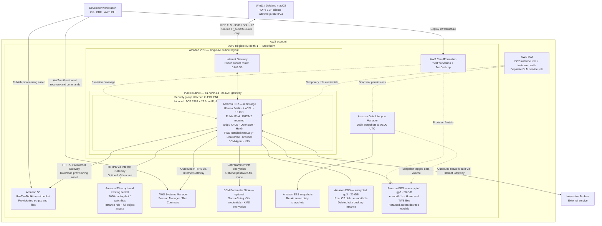

# Workstation architecture

This diagram describes the current CDK source and default configuration, not a verified live deployment. AWS resource names are used; diagram boxes are schematic, not official AWS icons.

## Ownership and lifecycle

| Layer                   | Managed resources                                                                      | Behavior                                                                                                      |
| ----------------------- | -------------------------------------------------------------------------------------- | ------------------------------------------------------------------------------------------------------------- |
| `TwsFoundation`         | VPC, subnet, routing, Internet Gateway, persistent EBS volume, DLM policy and DLM role | Kept during desktop teardown; stack termination protection enabled; data volume has retention policies.       |
| `TwsDesktop`            | EC2, root EBS disk, security group, instance role/profile, data-volume attachment      | Cleanly stop, destroy and recreate; existing data disk is reattached in the same AZ.                          |
| CDK bootstrap           | Deployment roles and S3 assets bucket                                                  | Created separately as `IbkrTwsToolkit` with qualifier `ibkrtws`; retained independently of the desktop stack. |
| Existing S3 data bucket | Optional user-selected bucket/prefix                                                   | Not created or deleted by this project. Bucket region may differ from the illustrated region.                 |

## Access and provisioning details

- xrdp listens on IPv4 TCP 3389. The security group allows RDP (3389) and SSH (22) only from the single public source IPv4 configured by `IP_ADDRESS` in local `.env`, normalized to `/32`. SSH requires public-key authentication; the TWS API has no inbound rule.
- RDP connects directly through the Internet Gateway with TLS. Tailscale is deferred and not installed. The EC2 public IPv4 is not an Elastic IP and can change after stop/start; the lifecycle status command shows the current destination.
- Routine administration and lifecycle shutdown checks use SSH as `trader`, with passwordless sudo (`sudo -i` for root); the authorized SSH key is sufficient for administration. Systems Manager remains an optional fallback and supports Parameter Store; it works through outbound connections; no inbound management port is required. No VPC endpoints, VPN gateway, NAT gateway or load balancer is configured.
- S3 and Systems Manager are regional services outside the VPC. EBS volumes are AZ resources attached to EC2, not resources inside its subnet. IAM is account-scoped.
- Cloud-init downloads a CDK S3 asset, installs packages, copies managed files and executes custom hooks. Systemd runs the every-boot hooks. Asset access uses the instance role, not stored AWS access keys.
- Localhost-only TWS API access is the recommended application setting; it must be enabled/configured in TWS. No separate IB Gateway process is provisioned.
- S3 mounting is disabled until a bucket is configured. The s3fs service mounts the selected prefix at `/mnt/watchlists` on every boot. It uses the instance role by default or an optional SecureString-backed `/etc/passwd-s3fs` (root:root 0600). Parameter Store/KMS are regional services outside the VPC; only EC2 fetches the decrypted value at runtime. S3 is not the home directory or a native shared filesystem.
- TWS installation, desktop password setup and IBKR login remain first-use operations. Rebuilds retain home data, not running application sessions.

## Updating the client IP

CDK re-reads local `.env` when synthesizing. Changing `IP_ADDRESS` and running `cdk diff TwsDesktop` / `cdk deploy TwsDesktop` updates only the ingress CIDR if no other inputs changed. It does not alter user data, provisioning assets or the instance. Deploying a previously synthesized assembly does not re-read `.env`. The source IP is not stored in Git but is necessarily present in the deployed security-group rule and generated templates.
